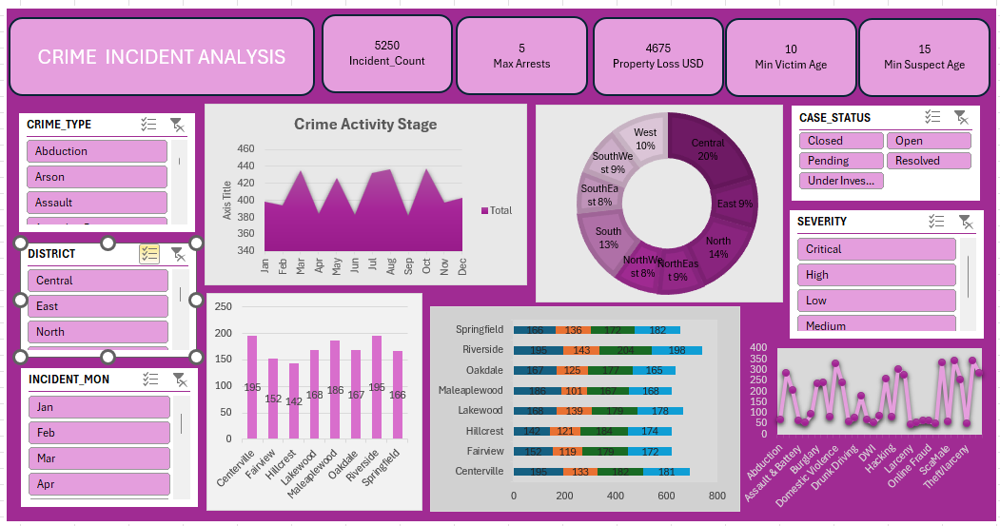

# 📊 Data Analytics Portfolio

## Crime Incident Analysis Dashboard (Excel)

An Excel-powered dashboard presenting crime statistics with filters by type, district, and case status. Designed to support decision-making with clear visualizations of monthly trends and severity distribution.

---

## 🔎 Project Overview
This project analyzes crime incident data for the year 2024.  
The dashboard provides insights into:
- Monthly crime trends
- District-level case distribution
- Case status breakdown (Open, Closed, Pending, etc.)
- Severity levels (Critical, High, Medium, Low)

---

## ✨ Features
- Interactive filters for **crime type**, **district**, and **incident month**
- Line chart showing **monthly crime totals**
- Bar chart comparing **district-level case counts**
- Donut chart visualizing **case status distribution**
- Severity categorization for better prioritization

---

## 📂 Repository Contents
- `Crime Incident Analysis Dashboard.png` → Screenshot of the dashboard  
- `Summary on Crime Analysis.png` → Summary visualization  
- `README.md` → Documentation  

---

## 🖼️ Dashboard Preview

---

## 🚀 Usage
1. Download the Excel file (if provided in future updates).  
2. Open in **Microsoft Excel 2019 or later**.  
3. Use the slicers/filters to explore crime data interactively.  

---

## 📈 Future Improvements
- Add Power BI version for advanced interactivity  
- Expand dataset with more years and categories  
- Include predictive analytics for crime trend forecasting  

---

## 📬 Contact
Created by **Nandini**  
For portfolio/demo purposes.  
